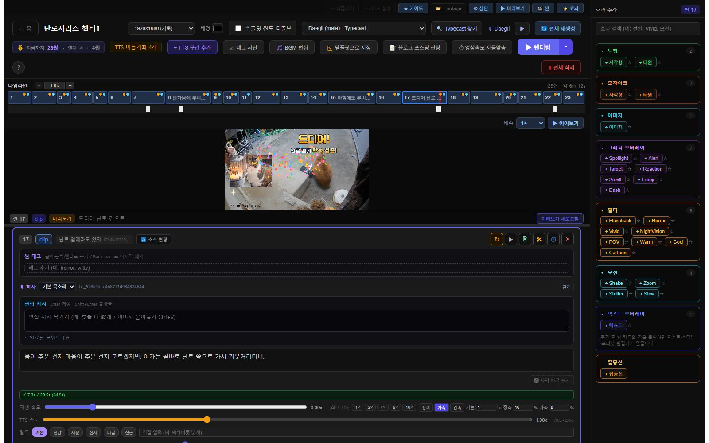
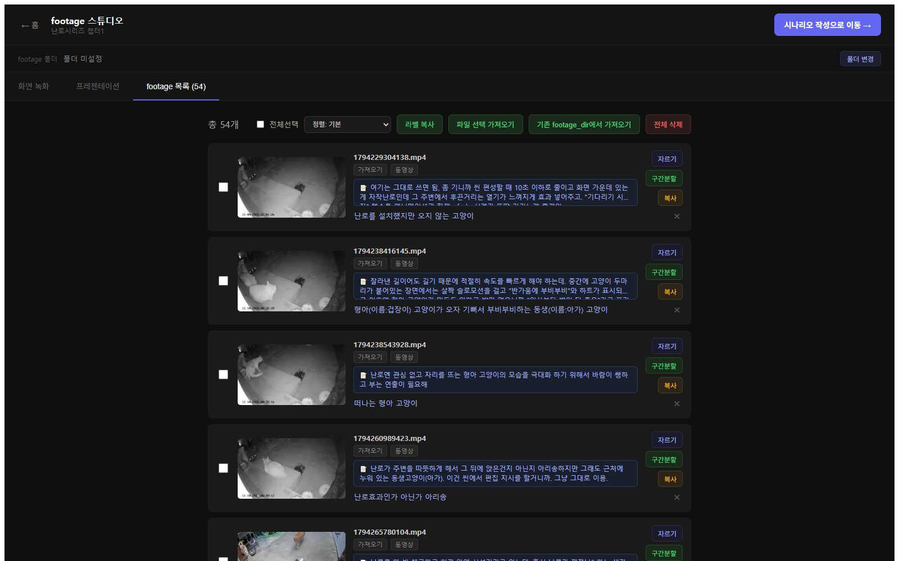
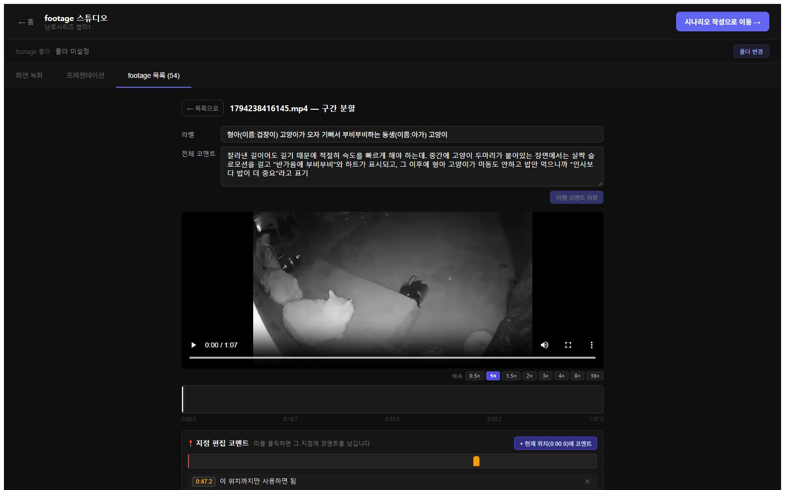
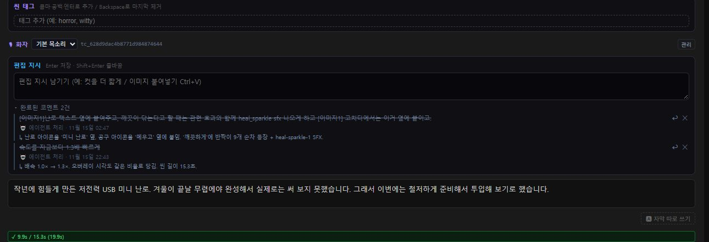

# video-agent

시나리오와 촬영 영상(footage)으로 나레이션·자막·효과가 붙은 완성 영상을 만드는 편집 도구입니다.
브라우저 편집기(React)와 로컬 백엔드(FastAPI + ffmpeg)로 이루어져 있습니다.
편집 지시는 씬 코멘트로 남기고, Claude Code가 그 코멘트를 읽어 반영합니다.

### 이 도구로 만들어 유튜브에 올린 영상

[](https://www.youtube.com/watch?v=7YWJJfEv0Mg)

**[길고양이 겨울나기, 작년 외면받았던 DIY 미니 난로 옆에 드디어 앉았습니다!](https://www.youtube.com/watch?v=7YWJJfEv0Mg)** — 호박어흥랜드

이 프로그램으로 실제로 만들어 유튜브에 올린 영상입니다.
- 마당 CCTV 영상을 스튜디오에서 구간별로 나누고, 푸티지 코멘트로 쓸 장면을 정했습니다.
- 씬 구성·배속·자막·효과음은 편집 지시 코멘트를 Claude Code가 반영해 다듬었습니다.
- 아래 캡처는 모두 이 영상의 편집 화면입니다.



- 화면: `web/frontend` (Vite + React, 포트 5173)
- 서버: `web/backend` (FastAPI, 포트 8000) + `src/` (렌더 파이프라인)
- 프로젝트 데이터: `web/data/{project_id}/` (`state.json`, footage, 산출물). 저장소에는 커밋하지 않습니다.

> **문의·요청:** 이 저장소는 GitHub 이슈와 PR을 받지 않습니다. 버그 제보나 기능 요청은 이메일(dolja21@gmail.com)로 보내 주세요.

---

## 1. 준비물

| 항목 | 버전 / 비고 |
|---|---|
| Python | 3.11 이상 |
| [uv](https://docs.astral.sh/uv/) | 파이썬 의존성·실행 관리 |
| Node.js | 20 이상 권장 (npm 포함) |
| ffmpeg / ffprobe | 4.4 이상. 아래 "ffmpeg 위치" 참고 |
| Git Bash (Windows만) | 프론트 실행 전 타입 생성 스크립트(`scripts/gen_ts_types.sh`)가 bash로 돕니다 |

**ffmpeg 위치.** `src/utils/ffmpeg_utils.py`가 아래 순서로 찾습니다.
1. 환경변수 `VIDEO_AGENT_FFMPEG` / `VIDEO_AGENT_FFPROBE`
2. 저장소 안 `tools/ffmpeg-*/bin/` (로컬 전용, 커밋 안 함)
3. `PATH`

PATH에 오래된 ffmpeg(4.3 이하)가 먼저 잡히면 미리보기가 실패합니다. 이때는 2번 위치에 최신 빌드를 풀어 두면 됩니다.

## 2. 설치 (처음 한 번)

```bash
uv sync                       # 파이썬 의존성
cd web/frontend && npm install
cp .env.example .env          # 저장소 루트에서. 키 값 채우기
```

API 키와 인증 파일 준비는 [`docs/credentials-guide.md`](docs/credentials-guide.md)를 참고하세요.

## 3. 서버 실행

백엔드와 프론트를 **각각 다른 터미널**에서 띄웁니다. 둘 다 저장소 루트에서 시작합니다.

### Windows (PowerShell)

```powershell
# 터미널 1 — 백엔드 (포트 8000)
$env:PYTHONUTF8='1'; $env:PYTHONIOENCODING='utf-8'; $env:UV_NO_SYNC='1'
uv run uvicorn web.backend.main:app --reload --host 0.0.0.0 --port 8000
```

```powershell
# 터미널 2 — 프론트 (포트 5173)
$env:PATH = "C:\Program Files\Git\bin;" + $env:PATH
Set-Location web\frontend
npm run dev
```

### macOS / Linux

```bash
# 터미널 1 — 백엔드
PYTHONUTF8=1 PYTHONIOENCODING=utf-8 UV_NO_SYNC=1 \
  uv run uvicorn web.backend.main:app --reload --host 0.0.0.0 --port 8000

# 터미널 2 — 프론트
cd web/frontend && npm run dev
```

브라우저에서 **http://localhost:5173** 을 엽니다. 프론트가 `/api`, `/ws` 요청을 8000번 백엔드로 넘깁니다.
백엔드는 `Application startup complete.`, 프론트는 `VITE ... ready` 가 보이면 준비된 것입니다. 백엔드는 처음 뜰 때 시간이 조금 걸립니다.

### 꼭 지킬 것

| 규칙 | 이유 |
|---|---|
| 백엔드는 `PYTHONUTF8=1`로 띄운다 | 없으면 한글 경로·자막 처리에서 렌더가 실패합니다 |
| 백엔드가 떠 있는 동안 `uv run`은 항상 `UV_NO_SYNC=1`로 | 자동 동기화가 실행 중인 환경의 패키지를 지워 백엔드가 죽은 적이 있습니다 |
| Windows에서 프론트 전에 Git Bash를 PATH 앞에 | 그렇지 않으면 `bash`가 WSL로 잡혀 타입 생성 단계에서 실패합니다 |
| 백엔드를 재시작할 때 자식 프로세스까지 종료 | `--reload` 리로더만 끄면 자식 프로세스가 8000번 포트를 계속 잡고 있습니다 |
| `state.json`을 손으로 고치지 않는다 | 백엔드는 시작할 때 한 번만 읽습니다. 고칠 일이 있으면 API(아래 5장)를 씁니다 |

코드를 고치면 백엔드는 `--reload`로, 프론트는 Vite가 자동 반영합니다. 모델(필드) 변경이 반영됐는지는 http://localhost:8000/openapi.json 에서 확인할 수 있습니다.

## 4. 기본 사용 흐름

1. **스튜디오:** footage를 올리고, 영상에 **푸티지 코멘트**로 쓸 장면과 대사를 적습니다. Claude Code가 이를 읽어 프로젝트(씬)를 만듭니다(5.1).
2. **편집기:** 씬별로 영상·나레이션·자막·텍스트·이미지·효과음을 다듬습니다. 고칠 점은 **씬 편집 지시**로 남기면 Claude Code가 반영합니다(5.2). 미리보기로 확인합니다.
3. **렌더링:** 편집기 상단 도구 모음의 `▶ 렌더링`을 누릅니다. `▾` 메뉴에 "영상만 렌더링"과 "자막만 생성"이 있습니다.
4. 결과는 `web/data/{project_id}/output/final_output.mp4`(+ `.sbv` 자막)에 저장됩니다.

렌더 단계별 소요 시간은 `output/render_timing.json`에 기록됩니다.

### 4.1 렌더 속도

- **클립 캐시:** 씬 클립을 자르고 배속을 건 결과를 `web/data/{project_id}/cache/scene-XXX/render-clip-*.mp4`에 저장합니다. 원본·구간·배속·해상도 같은 설정이 그대로면 다음 렌더에서 다시 만들지 않고 재사용합니다. 고배속 씬처럼 오래 걸리는 씬에서 효과가 큽니다.
  - 미리보기 캐시와 함께 프로젝트당 1GB 한도 안에서 오래된 것부터 지웁니다.
  - 씬별 적중 여부는 `render_timing.json`의 `clip_cache`에서 볼 수 있습니다.
- **디졸브 연결:** 예전에는 디졸브를 넣으려고 영상 전체를 두 번 다시 인코딩했습니다. 지금은 씬 가운데는 그대로 복사하고, 디졸브가 걸리는 경계 구간만 다시 인코딩합니다.
  - 합성 클립 시험(1080p, 12개, 약 93초)에서 27.4초 → 8.2초로 줄었습니다.
  - 프레임 수·형식 검사에 하나라도 어긋나면 기존 방식(전체 xfade)으로 자동 전환합니다.

| 환경변수 | 기본값 | 설명 |
|---|---|---|
| `RENDER_DISSOLVE_MODE` | `boundary` | `boundary` = 경계 구간만 재인코딩, `full` = 기존 전체 xfade |
| `RENDER_XFADE_WORKERS` | `3` | 전체 xfade를 쓸 때 묶음을 동시에 처리하는 수. `1`이면 순차 처리 |

짧은 클립이 아주 많거나 형식이 제각각인 프로젝트에서는 `boundary`가 오히려 느릴 수 있습니다. 경계 구간을 CPU(libx264)로 인코딩하기 때문입니다. 이럴 때는 `RENDER_DISSOLVE_MODE=full`로 바꿔 보세요.

### 4.2 효과음·BGM

- **효과음 프리셋:** 기본 효과음은 저장소 안 `assets/sfx_presets/`에 들어 있습니다. 다른 프로젝트 폴더가 없어도 목록·미리듣기·렌더에서 동작합니다.
  - 효과음은 `preset:{키}`로 참조합니다(예: `preset:coin-pickup-1`). 키 이름은 예전과 같아서 기존 프로젝트를 고칠 필요가 없습니다.
  - 재배포 허용이 확인되지 않은 외부 출처 파일 몇 개는 저장소에 넣지 않았습니다. 그 파일이 없는 환경에서는 해당 키만 목록에서 빠집니다.
  - 직접 올린 효과음(`web/data/_sfxlib`)은 지금처럼 모든 프로젝트에서 같이 씁니다.
- **BGM:** 프로젝트에 등록한 오디오만 BGM으로 쓸 수 있습니다. 스튜디오에서 오디오를 올리거나 BGM 편집 화면에서 파일을 추가하면 등록됩니다.
- **템플릿 BGM:** 프로젝트를 템플릿으로 저장하면 BGM 파일도 템플릿 폴더(`web/data/_templates/{id}/bgm/`)에 함께 저장됩니다. 그 템플릿으로 새 프로젝트를 만들면 BGM이 프로젝트 오디오로 자동 등록되고 트랙에 연결됩니다.



## 5. Claude와 코멘트로 작업하기

화면에서는 코멘트만 남기고, 실제 분석·편집은 에이전트(Claude Code 등)가 video-agent API로 처리합니다. 코멘트는 두 종류입니다.

| 코멘트 | 위치 | 쓰는 단계 |
|---|---|---|
| **푸티지 코멘트** (📍 지점 편집 코멘트 + 영상 전체 코멘트) | 스튜디오 → 자산의 구간 분할 화면 | 프로젝트 만들기: 어느 구간을 쓰고 무슨 대사를 넣을지 |
| **씬 편집 지시** | 편집기 → 씬 카드의 "편집 지시" 칸 | 만든 뒤 다듬기: 컷 길이, 배속, 자막 위치 등 |

프로젝트 ID는 편집기 주소창의 `pid=` 값입니다(`http://localhost:5173/?screen=editor&pid=...`).

**에이전트 연결.** 에이전트는 이 저장소 폴더에서 실행할 필요가 없습니다. 서버(3장)에 HTTP로 닿기만 하면 다른 폴더나 다른 프로젝트에서 일하던 에이전트도 붙여 쓸 수 있습니다. 처음 한 번은 API 사용법을 먼저 익히게 합니다.
- 읽힐 것
  - 이 README의 5장
  - 전체 API 명세: `http://localhost:8000/openapi.json` (사람이 볼 때는 `http://localhost:8000/docs`)
- 지켜야 할 규칙
  - 데이터는 API로만 읽고 씁니다(`state.json` 직접 수정 금지).
  - 코멘트 처리가 끝나면 완료 처리(`resolve`)까지 합니다.
- 요청 예시:
  ```
  video-agent API 사용법을 먼저 익혀줘. README는 <저장소 경로>/README.md 5장,
  명세는 http://localhost:8000/openapi.json. 그다음 편집 지시 반영해줘 (프로젝트 ID: ...)
  ```

### 5.1 프로젝트 만들기 — 푸티지 코멘트

1. **스튜디오에서 footage를 올립니다.** 녹화, 파일 업로드, 기존 폴더 가져오기 중 하나입니다.
2. (선택) **Claude에게 장면 설명을 만들게 합니다.**
   ```
   장면 설명 데이터 만들어줘 (프로젝트 ID: ...)
   ```
   Claude가 영상 10초 구간마다 가장 선명한 프레임을 뽑아 직접 보고 구간별 설명을 씁니다. 결과는 `web/data/{pid}/scene_index.json`에 저장됩니다.
   구간 분할 화면의 장면 검색과 프레임 띠에서 이 설명으로 원하는 장면을 찾을 수 있습니다.
3. **자산을 열어 구간 분할 화면에서 코멘트를 남깁니다.**
   - **📍 지점 편집 코멘트:** 띠를 클릭하거나 `+ 현재 위치에 코멘트`를 눌러 그 시각에 지시를 꽂습니다.
     - 예: `이 지점 앞 3초~뒤 5초 잘라서 "드디어 난로 곁으로" 씬으로`
     - 예: `여기서 "이것이 뭐여?" 자막`
   - **영상 전체 코멘트:** 그 영상 전체에 대한 메모입니다(내용 요약, 쓸 곳, 주의점).
   - 영상을 조각으로 나눠 저장하면, 조각 범위 안의 코멘트가 조각 기준 시각으로 옮겨집니다.

   
4. **Claude에게 코멘트대로 프로젝트를 구성하게 합니다.**
   ```
   푸티지 코멘트대로 프로젝트 만들어줘 (프로젝트 ID: ...)
   ```
   Claude는 다음 정보를 읽어 씬을 구성하고 API로 등록합니다.
   - 자산 목록과 코멘트: `GET /api/projects/{pid}/studio/assets` (`markers`, `note`)
   - 장면 설명: `GET /api/projects/{pid}/studio/scene-index`
   - 등록: `PUT /api/projects/{pid}/register`
   - 씬마다 쓸 구간, 나레이션 문장, 자막이 이렇게 정해집니다.
5. 편집기에서 결과를 확인하고, 고칠 점은 5.2의 씬 편집 지시로 이어 갑니다.

푸티지 코멘트에는 완료 표시가 없습니다. 반영이 끝난 코멘트는 정리하거나 그대로 메모로 두면 됩니다.

### 5.2 다듬기 — 씬 편집 지시

편집기에서 씬마다 **편집 지시**를 코멘트로 남기면, Claude Code가 그 목록을 읽어 수정하고 완료 처리합니다.
사람은 화면에서 지시만 남기고, 결과를 확인한 뒤 필요하면 다시 엽니다.

#### 사람이 하는 일

1. 편집기에서 해당 씬 카드의 **"편집 지시"** 칸에 지시를 적습니다.
   - 예: `컷을 2초 더 짧게`, `7초부터 1.5배속`, `이 자막은 화면 위쪽으로`
   - 스크린샷은 `Ctrl+V`로 붙여 넣습니다. 본문에 `[이미지1]` 같은 자리표시자가 들어가고, Claude가 그 이미지를 직접 엽니다.
2. Claude Code에 이렇게 요청합니다.
   ```
   편집 지시 반영해줘 (프로젝트 ID: 6f311fd8-...)
   ```
3. 반영이 끝나면 코멘트가 **완료**로 바뀌고 "처리 메모"가 붙습니다. 미리보기나 렌더로 확인합니다.
4. 결과가 마음에 들지 않으면 완료된 코멘트의 **"다시 열기"**를 누르고 지시를 보충합니다. 다음 요청 때 다시 처리됩니다.

완료된 코멘트는 지워지지 않고 이력으로 접혀 남습니다. 언제 무엇을 고쳤는지 씬 카드에서 볼 수 있습니다.



#### Claude가 하는 일 (API)

Claude는 `state.json`을 직접 열지 않고 아래 API로만 읽고 씁니다.

| 순서 | 요청 | 용도 |
|---|---|---|
| 1 | `GET /api/projects/{pid}/comments/agent-queue` | 처리할 open 코멘트 목록 |
| 2 | `GET /api/projects/{pid}` | 현재 씬 상태 확인 |
| 3 | `PATCH /api/projects/{pid}/scenes/{scene_id}` | 씬 필드 부분 수정 (배속, 오버레이, 효과음 등) |
|   | `PUT /api/projects/{pid}/register` | 프로젝트 전체 등록(upsert). 여러 씬을 한 번에 바꿀 때 |
| 4 | `POST /api/projects/{pid}/scenes/{scene_id}/comments/{comment_id}/resolve` | 완료 처리 |

1번 응답에는 코멘트마다 다음이 들어 있어, 이 응답 하나로 무엇을 고칠지 알 수 있습니다.
- 지시 본문(`instruction`)
- 씬 문맥(제목·나레이션·길이)
- 붙임 이미지 경로(`images[].path`)
- 완료 처리 주소(`resolve_url`)

4번 요청 본문 예시입니다.

```json
{ "resolution_note": "7초 지점부터 1.5배속 적용, 컷 길이 12.0→10.0초", "resolved_by": "agent" }
```

이미 완료된 코멘트에 다시 `resolve`하면 409를 돌려줍니다(이력 덮어쓰기 방지). 되돌리기는 `.../reopen`입니다.

### 5.3 지시를 잘 쓰는 요령 (두 코멘트 공통)

- **시점은 씬 안의 초 단위로** 적습니다(`씬 기준 7초부터`). 화면 시계나 촬영 시각보다 정확합니다.
- **기존 값 기준인지 절대값인지** 밝힙니다. 예: `지금 배속에 1.5배 더` / `1.5배속으로`
- 기능이 없는 요청이면, 저장소 코드에 접근할 수 있는 에이전트는 새 기능을 만들어 반영할 수도 있습니다. 원하지 않으면 지시에 "기존 기능으로만"이라고 적습니다. API로만 붙은 에이전트는 기존 기능 범위에서 처리합니다.
- 나레이션(TTS) 음성은 비용이 드는 작업이라, 재생성이 필요하면 지시에 명시하세요.

## 6. 비가시 워터마크

최종 영상에 눈에 보이지 않는 제작자 표식(256비트)을 넣는 기능입니다.

- **모델:** Meta [Video Seal](https://github.com/facebookresearch/videoseal) 저장소의 **PixelSeal**을 씁니다. 코드와 모델 모두 MIT 라이선스입니다.
- **넣는 내용:** `SHA-256(제작자 ID)`. 같은 ID는 항상 같은 값이 나와서 검증할 때 다시 계산할 수 있습니다.

### 6.1 사용

- 렌더 버튼 옆의 `🔏 워터마크` 토글을 켭니다. 기본은 꺼져 있습니다.
- 켜면 최종 합성 직전에 한 번만 넣고, 그 뒤에는 영상을 다시 압축하지 않습니다.
- 속도는 1080p 기준 약 44fps입니다(GTX TITAN X). 10분짜리 영상이면 렌더가 7분쯤 늘어납니다.
- 넣을 때마다 `output/watermark_log.json`에 다음을 남깁니다.
  - 원본·결과 파일 해시
  - 페이로드
  - 모델
  - 시각

**의심 파일 검사**

```powershell
$env:UV_NO_SYNC='1'; uv run python -m src.watermark "의심파일.mp4"
```

```
파일        : 의심파일.mp4
해상도/샘플 : 1280x720, 전체 900프레임 중 300장 검사
제작자 ID   : video-agent  (페이로드 74628403b3965e16…)
  pixelseal  비트 일치율 1.0000
  videoseal  비트 일치율 0.5000
판정        : ✅ 워터마크 있음 — 페이로드 일치 (최고 1.0000 / 기준 0.7, 모델 pixelseal)
삽입 기록   : 같은 제작자·모델의 최근 기록(후보 — 파일이 편집·재압축돼 해시로는 특정 불가) 1건
  - 2026-11-20T03:00:00+00:00  프로젝트 3ad9702c-…  1920x1080  pixelseal (256b)  (…/output/watermark_log.json)
```

- 영상 전체에서 고르게 최대 300장을 뽑아 검사합니다. 1080p 30초 영상 기준 두 모델 검사에 약 40초가 걸립니다(모델 로드 포함).
- 모든 프로젝트의 `watermark_log.json`과 대조합니다.
  - 파일 해시가 기록과 똑같으면: 그 기록과 기록된 모델로 검사합니다.
  - 해시가 다르면(재압축·편집본): 두 모델로 모두 검사하고, 같은 제작자·모델의 최근 기록을 후보로 보여 줍니다.
- 옵션
  - `--creator 다른ID`: 다른 제작자 ID로 검사
  - `--model pixelseal`: 모델 고정
  - `--json`: 결과를 JSON으로 출력
- 종료 코드: 검출되면 0, 아니면 1

### 6.2 별도 환경 설치

PyTorch는 프로젝트 환경에 넣지 않고 따로 둡니다. 기본 위치는 저장소 두 단계 위의 `wm-lab/`입니다.

```powershell
cd ..\..                    # 저장소 폴더에서 두 단계 위로
mkdir wm-lab; cd wm-lab
uv venv --python 3.12
uv pip install --python .venv\Scripts\python.exe torch torchvision --index-url https://download.pytorch.org/whl/cu126
git clone https://github.com/facebookresearch/videoseal
uv pip install --python .venv\Scripts\python.exe -r videoseal\requirements.txt requests
```

모델 파일은 처음 렌더할 때 `videoseal/ckpts/`로 자동으로 내려받습니다.

위치를 바꾸거나 설정을 바꾸려면 `.env`에 다음 항목을 넣습니다.

| 환경변수 | 기본값 | 뜻 |
|---|---|---|
| `WATERMARK_PYTHON` | `../../wm-lab/.venv/Scripts/python.exe` | 별도 환경의 파이썬 |
| `VIDEOSEAL_DIR` | `../../wm-lab/videoseal` | Video Seal 저장소 위치 |
| `WATERMARK_CREATOR_ID` | `video-agent` | 페이로드로 넣을 제작자 ID |
| `WATERMARK_MODEL` | `pixelseal` | `pixelseal` 또는 `videoseal`. 검증할 때도 같은 모델을 써야 합니다 |

### 6.3 견고성 측정

- 수치는 비트 일치율입니다. **0.70 이상이면 "있음"으로 판정**합니다.
- 워터마크가 없는 영상 124개 구간에서는 평균 0.495, 최대 0.582가 나왔습니다. 0.70 기준에서 오탐률은 이론상 약 3×10⁻¹¹입니다.
- 샘플은 이 도구로 만든 실제 영상입니다.

**재압축·축소·크롭**

| 유형 | 720p CRF28 | 720p CRF32 | 480p | 크롭 80% | 크롭 50% |
|---|---|---|---|---|---|
| 실사 | 1.000 | 1.000 | 1.000 | 1.000 | ❌ 0.52 |
| 그래프 슬라이드 | 0.973 | 0.926 | 0.977 | 0.977 | ❌ |
| 텍스트 슬라이드 | 0.996 | 0.969 | 0.988 | 0.988 | ❌ |
| 모션그래픽 | 0.996 | 0.981 | 0.996 | 1.000 | ❌ |

- 크롭 50%는 #409에서 기존 모델(Video Seal)로 측정한 결과이고, 모든 유형이 0.45~0.70으로 실패했습니다.
- 나머지 칸은 PixelSeal로 측정한 값입니다.

**편집·재가공** (샘플 7개: 실사 2, 슬라이드 3, 게임 1, 세로숏츠 1)

| 조건 | 결과 |
|---|---|
| 1.25배속 | 전부 0.98 이상 |
| 30→24fps 변환 | 전부 0.98 이상 |
| 10초·5초만 잘라냄 | 전부 0.98 이상 |
| 화면 녹화 근사 (축소 + 색 변화 + 재압축) | 그래프 슬라이드만 ❌ 0.543, 나머지 0.86 이상 |

**다른 워터마크와 겹칠 때**

| 상황 | 우리 표식 | 상대 표식 |
|---|---|---|
| 우리 영상에 다른 방식(TrustMark)을 덧넣음 | 0.93 이상, 720p 재압축 후 0.81 이상 | 정상 |
| 다른 방식이 이미 있는 소재에 우리 것을 넣음 | 1.000 | 숏츠에서 31%로 손상 |
| 우리 영상에 같은 방식으로 다른 메시지를 덧넣음 | ❌ 0.51 (완전히 덮임) | — |

**모델 선택 근거** (Video Seal vs PixelSeal, 강도는 둘 다 0.2)

| 조건 | Video Seal | PixelSeal |
|---|---|---|
| 그래프 슬라이드 CRF32 | 0.770 | 0.926 |
| 그래프 슬라이드 2회 재압축 | 0.758 | 0.984 |
| 실사 화질(PSNR) | 46.2 | 46.5 |
| 속도 | 42.7fps | 43.9fps |

- Video Seal은 강도를 0.5까지 올려도 그래프 슬라이드가 나아지지 않았습니다.

### 6.4 한계

- **화면의 절반 이상을 잘라내면** 검출되지 않습니다.
- **밝은 단색 면이 많은 슬라이드에 밝기·대비를 바꾸면** 검출되지 않습니다.
  - 흰 배경이 잘리면서 표식이 함께 사라지는 것으로 추정합니다.
  - 밝기 +3%나 대비 +5%만으로도 실패했습니다.
  - 화면 녹화의 색 범위(limited/full)가 어긋날 때 이런 변화가 생길 수 있습니다.
- **같은 모델로 다른 메시지를 덧넣으면 덮입니다.** 모델이 공개돼 있어서 막을 수 없습니다.
  - 이때는 `watermark_log.json`의 원본·결과 해시와 시각이 먼저 만들었다는 근거가 됩니다.
- **원본 소재에 다른 회사의 워터마크가 있으면** 우리 삽입이 그 표식을 손상시킬 수 있습니다.
- 워터마크는 출처를 추적하는 보조 수단이고, 복제를 막지는 못합니다.

## 7. 개발 문서

| 문서 | 내용 |
|---|---|
| [`CLAUDE.md`](CLAUDE.md) | 에이전트 운영 규약(역할·브랜치·이슈 흐름) |
| [`docs/technical-design.md`](docs/technical-design.md) | 기술 설계 |
| [`docs/render-spec.md`](docs/render-spec.md) | 렌더 스펙(미리보기·렌더 공통 모델) |
| [`docs/adding-effect.md`](docs/adding-effect.md) | 효과 추가 방법 |
| [`docs/testing-guide.md`](docs/testing-guide.md) | 테스트 방법 |
